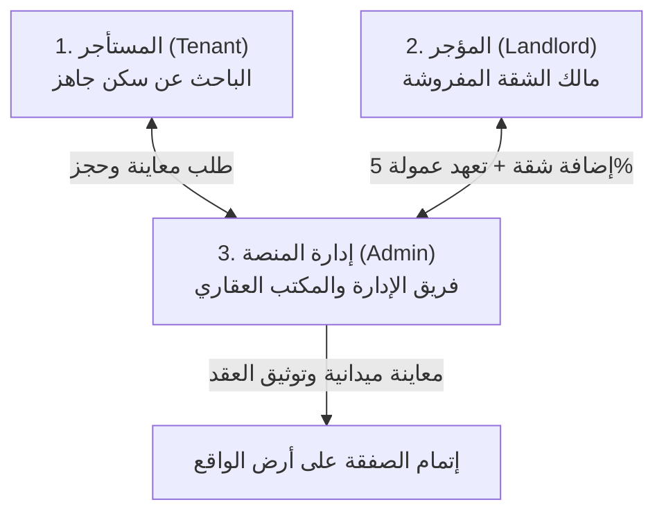

# وثيقة مواصفات وتشغيل منصة سكن (SAKAN)
**نظام إدارة وتأجير الشقق المفروشة**

---

## 1. نظرة عامة على المشروع (Project Overview)

منصة **"سكن - SAKAN"** هي منصة رقمية وسيطة متخصصة في عرض وتأجير **الشقق المفروشة الجاهزة**، وتعمل بنموذج وساطة موثوقة وميدانية تحت إشراف **«إدارة المنصة / المكتب العقاري المشرف»**.

* **الهدف الأساسي:** تنظيم وتسهيل العثور على شقق مفروشة موثوقة، والحد من العشوائية والاحتيال في السوق العقاري، مع ضمان حقوق المؤجر والمستأجر عبر جهة ضامنة ومشرفة.
* **النموذج المالي:** عمولة تشغيلية بنسبة **5%** تُدفع من قبل مالك العقار (المؤجر) للمكتب المشرف عند إتمام كل صفقة تأجير بنجاح.
* **العملات المدعومة:** الجنيه السوداني (SDG) والدولار الأمريكي (USD).

---

## 2. أطراف ومستخدمو النظام (System Roles & Actors)

يتكون النظام من ثلاثة أطراف رئيسية مترابطة:

### 1. المستأجر (Tenant / Customer)
* **الوصف:** أي فرد أو عائلة أو جهة تبحث عن شقة مفروشة لفترات قصيرة أو متوسطة أو طويلة.
* **المهام والصلاحيات في النظام:**
  * تصفح قائمة الشقق المفروشة والاطلاع على الصور والمواصفات المعتمدة.
  * البحث المتقدم والفلترة حسب: المدينة/الحي، نطاق السعر، العملة، والمرافق (تكييف، مصعد، إنترنت، مصدر طاقة... إلخ).
  * تقديم طلب رسمي لمعاينة الشقة مع تحديد التاريخ والوقت المناسبين.
  * متابعة حالة طلباته (معلق، تم التنسيق، منتهي) من خلال تبويب **"الحجوزات"**.
  * حفظ العقارات المفضلة للرجوع إليها لاحقاً.

### 2. المؤجر / مالك العقار (Landlord / Owner)
* **الوصف:** صاحب الشقة المفروشة الذي يرغب في عرضها للإيجار والوصول لمستأجرين جادين.
* **المهام والصلاحيات في النظام:**
  * تسجيل حساب وتأكيد رقم الهاتف.
  * إضافة عقار جديد: رفع صور الشقة، تحديد العنوان والموقع، اختيار العملة وتحديد السعر، تحديد عدد الغرف والحمامات، وتحديد المرافق والخدمات المتوفرة.
  * الموافقة الإلزامية على التعهد بدفع عمولة المكتب المشرف (5%) كشرط أساسي لرفع العقار.
  * إدارة عقاراته من تبويب **"حسابي / عقاراتي"**: (تعديل تفاصيل الشقة، تعديل الأسعار، تغيير حالة العقار إلى متاح أو محجوز أو مؤجر).
  * الاطلاع على سندات القبض الإلكترونية للعمولات المدفوعة.

### 3. إدارة المنصة والمكتب العقاري المشرف (Platform Admin & Real Estate Staff)
* **الوصف:** المشرف والضامن الميداني المسؤول عن تشغيل المنصة وضمان موثوقيتها وصحة المعاملات.
* **الصلاحيات والمهام (عبر لوحة التحكم - Admin Dashboard):**
  * **مراجعة وتفعيل العقارات:** فحص البيانات والصور والتأكد من جدية المالك قبل تفعيل العقار ليظهر للعامة.
  * **إدارة طلبات المعاينة:** استلام طلبات المستأجرين والتنسيق الهاتفي والميداني بين الطرفين.
  * **إدارة وتتبع العمولات (5%):** رصد وتوثيق سداد نسبة الإدارة، وإصدار إيصالات وسندات قبض رسمية.
  * **إدارة المستخدمين:** تفعيل أو حظر الحسابات المخالفة أو الإعلانات المضللة.
  * **إحصائيات وتقارير:** متابعة المناطق الأكثر طلباً، ونسب الإشغال، والإيرادات الشهرية.

---

## 3. آلية ودورات العمل خطوة بخطوة (System Workflows)

### المرحلة الأولى: دورة حياة العقار (من الإضافة حتى النشر)
1. يقوم المؤجر بالدخول والضغط على زر **"أضف عقار جديد"**.
2. يُدخل المؤجر بيانات الشقة بالتفصيل، ويرفع الصور، ويحدد العملة والسعر والمرافق.
3. يوافق المؤجر على نص التعهد بدفع عمولة 5% لـ **«إدارة المنصة / المكتب العقاري المشرف»**.
4. يدخل العقار تلقائياً في حالة: **`قيد المراجعة (Pending)`**.
5. يظهر إشعار في لوحة إدارة المنصة لدى الموظف المختص، فيراجع البيانات ويتواصل مع المالك للتحقق.
6. يتم اعتماد العقار ليصبح بحالة: **`نشط (Active)`**، ويظهر فوراً في شاشة التصفح الرئيسية للمستأجرين.

### المرحلة الثانية: دورة البحث وطلب المعاينة (حماية قنوات التواصل)
1. يتصفح المستأجر التطبيق ويفلتر العقارات حسب متطلباته وميزانيته.
2. يدخل على تفاصيل الشقة ويضغط على زر **"طلب معاينة الشقة"** مع اختيار اليوم المناسب.
3. **سياسة عدم التجاوز:** لا يتم إظهار رقم هاتف المالك للمستأجر لتفادي التواصل الخارجي وتجاوز المكتب المشرف.
4. يذهب الطلب مباشرة إلى لوحة تحكم إدارة المنصة بحالة **`طلب جديد (New Request)`**.
5. يتصل مندوب المنصة بالمستأجر لتأكيد الجدية، ثم ينسق مع المالك لتحديد وقت الزيارة الميدانية.

### المرحلة الثالثة: المعاينة وإتمام الصفقة والتحصيل
1. تتم المعاينة الميدانية للشقة برفقة مندوب المكتب العقاري المشرف.
2. في حال الاتفاق: يتم توقيع عقد الإيجار الرسمي بضمان وإشراف إدارة المنصة.
3. يدفع المالك عمولة الـ 5% للمكتب العقاري المشرف.
4. يقوم موظف الإدارة في لوحة التحكم بتحويل حالة العقار إلى: **`مؤجر (Rented)`**، ويُسجل استلام العمولة في النظام لتوليد سند قبض إلكتروني موثق.

---

## 4. مصفوفة الصلاحيات والمسؤوليات (RACI Matrix)

| الإجراء / العملية | المستأجر | المؤجر (المالك) | إدارة المنصة / المكتب المشرف |
| :--- | :---: | :---: | :---: |
| إضافة عقار جديد والإقرار بالعمولة | - | مسؤول (Responsible) | مراجع (Consulted) |
| مراجعة واعتماد نشر العقار | - | - | مسؤول ومعتمد (Accountable) |
| البحث واستعراض الشقق والفلترة | منفذ (Responsible) | - | مراقب (Informed) |
| طلب موعد معاينة | منفذ (Responsible) | مُخطر (Informed) | منسق وضامن (Accountable) |
| المعاينة الميدانية للشقة | مشارك | مشارك | وسيط وضامن |
| توقيع العقد وتسليم الشقة | طرف متعاقد | طرف متعاقد | مشرف وموثّق |
| دفع عمولة الـ 5% وتوثيقها | - | دافع (Responsible) | محصّل وموثّق (Accountable) |

---

## 5. قرارات تصميمية معتمدة (Design Decisions)

* **صياغة عامة للإشراف:** اعتماد وصف عام مرن («إدارة المنصة / المكتب العقاري المشرف») ليكون النظام قابلاً للتطبيق والتوسع لأي مكتب أو جهة عقارية تدير المنصة.
* **استبعاد المساعد الذكي:** تم إلغاء شريط ومساعد "واكا الذكي" نهائياً، لضمان واجهة سريعة، بسيطة، وغير مشتتة للمستخدم، مع خفض التكاليف التشغيلية.
* **دعم العملات المتعددة:** تمكين المالك من الاختيار المستقل بين الجنيه السوداني أو الدولار الأمريكي لكل عقار على حدة.
* **حماية بيانات التواصل:** يتم التواصل حصرياً عبر قنوات إدارة المنصة لحماية العمولة وضمان جدية العمليات.

---

## 6. الخطوات التالية للبدء بالتنفيذ

1. **تحديد حزمة التقنيات (Tech Stack):** اختيار تقنيات الواجهات الأمامية، الخلفية، وقاعدة البيانات.
2. **تصميم لوحة الإدارة (Admin Dashboard):** تحديد شاشات الموظفين لمراجعة العقارات والحجوزات والعمولات.
3. **تصميم قاعدة البيانات (Database Schema):** بناء الجداول (Users, Properties, Amenities, Bookings, Commissions).
